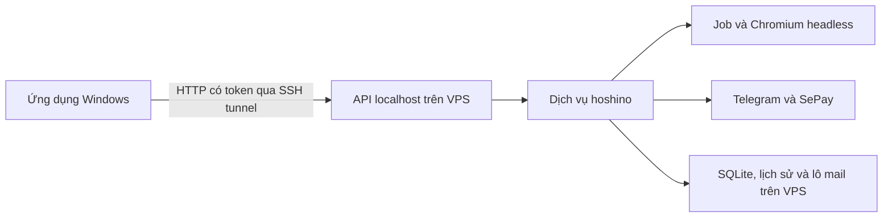

# Chạy trên Ubuntu, quản lý bằng ứng dụng Windows

Ứng dụng Windows mặc định mở chế độ quản lý VPS. Job, Chromium, bot Telegram,
hẹn giờ, SQLite và đồng bộ SePay chạy trong dịch vụ `hoshino` trên VPS.
Đóng máy tính hoặc mất SSH tunnel không dừng job trên VPS.

## Kiến trúc triển khai



Dịch vụ hiện tái sử dụng các controller PySide6 đã có, với Qt `offscreen` và không
mở cửa sổ. Đây là bước tương thích để giữ nguyên logic hàng đợi, tiền và bot;
backend vẫn cần gói PySide6. Giao diện quản lý Windows không tạo controller xử lý
job, không polling Telegram và không mở cơ sở dữ liệu vận hành local.

## Mở ứng dụng quản lý

1. Chạy `Open_VPS_Tunnel.bat`, đăng nhập SSH và giữ cửa sổ mở.
2. Chạy `Launch_HoshinoTool.bat` hoặc `Launch_VPS_Manager.bat`.
3. Nhập token quản lý, bấm **Kết nối VPS**. URL mặc định: `http://127.0.0.1:8765`.
4. Nhập cấu hình tại **Cài đặt chung**, nhập proxy tại hai trang proxy riêng,
   cấu hình bot/SePay tại **Telegram**. Các API key để trống khi sửa sẽ được giữ nguyên.

VPS hiện dùng SSH `root1@sv50.pcrender.net`, cổng `20052`. Launcher không chứa
mật khẩu SSH. Nếu triển khai đã tạo `data/remote_connection.json`, ứng dụng tự đọc
URL/token từ file này; file nằm ngoài Git. Có thể xóa file để nhập token mỗi phiên.
Khóa SSH máy chủ được lưu tại `data/vps_known_hosts`; đối chiếu fingerprint khi
kết nối lần đầu. API chỉ bind `127.0.0.1`; không cần mở cổng 8765 trên firewall.

Trên máy Windows mới, cài Python >=3.11, rồi chạy:

```powershell
python -m venv .venv
.venv\Scripts\python.exe -m pip install -r requirements.txt
```

Các launcher cũ nay mở chế độ quản lý. Khi cần mở bản local để xuất dữ liệu:

```powershell
.venv\Scripts\python.exe -I main_mochi_gui.py --local
```

## Cài dịch vụ trên Ubuntu

Dùng Python >=3.11 riêng cho ứng dụng (khuyến nghị 3.12); Ubuntu 22.04 mặc định
có Python 3.10 nên cần cài thêm Python trước. Không thay Python hệ thống. Có thể
dùng [uv để cài Python 3.12](https://docs.astral.sh/uv/guides/install-python/).

Đặt mã nguồn sạch ở `/opt/hoshino/app`, sau đó:

```bash
cd /opt/hoshino/app
sudo bash deploy/install_ubuntu.sh /path/to/python3.12
sudo env QT_QPA_PLATFORM=offscreen /opt/hoshino/venv/bin/python -I scripts/verify.py
sudo systemctl enable --now hoshino
sudo systemctl status hoshino
```

Trình cài cài thư viện Linux và Chromium bằng Playwright theo
[tài liệu chính thức](https://playwright.dev/python/docs/browsers). Cấu trúc:

| Đường dẫn | Nội dung |
|---|---|
| `/opt/hoshino/app` | Mã nguồn |
| `/opt/hoshino/venv` | Môi trường Python |
| `/etc/hoshino/runtime.env` | Token quản lý; chỉ root và nhóm dịch vụ được đọc |
| `/var/lib/hoshino` | Settings INI, SQLite, CSV, lô mail và trạng thái xoay proxy |
| `/var/lib/hoshino/browsers` | Chromium Linux |

Dịch vụ chạy bằng user hệ thống `hoshino`. Dữ liệu nằm riêng khỏi checkout;
cập nhật mã không ghi đè ví, lịch sử hoặc lô mail. systemd tự khởi động lại khi
dịch vụ gặp lỗi, và bật lại cùng VPS sau khi `enable`.

Lấy token khi cần trên phiên SSH riêng:

```bash
sudo cat /etc/hoshino/runtime.env
```

Không gửi token vào GitHub. Nếu mất phản hồi sau khi bấm tạo job, nối lại và
kiểm tra danh sách trước khi tạo lệnh mới. API ghi nhận `request_id` trước khi
thực hiện; gửi lại cùng ID/nội dung không tạo thêm job. Những lệnh bị gián đoạn
không rõ kết quả sẽ bị chặn tự lặp sau khi dịch vụ khởi động lại.

## Dữ liệu từ bản local

Dữ liệu local không tự đưa lên GitHub hoặc tự ghi đè dữ liệu VPS. Dịch vụ mới ban
đầu không có API mail/bot/SePay và không tự tạo job. Để chuyển dữ liệu cũ:

1. Đóng bản local và dừng bot/SePay local; không chạy hai nơi cùng một Bot Token.
2. Sao lưu SQLite bằng SQLite backup API; giữ CSV và toàn bộ `data/mail_batches/`.
3. Dừng `hoshino`, sao lưu `/var/lib/hoshino`, rồi chuyển bản sao dữ liệu vào đó,
   đặt quyền sở hữu `hoshino:hoshino` và quyền file `600`.
4. Nhập lại cấu hình qua ứng dụng quản lý, hoặc chuyển các thiết lập đã rà soát
   từ QSettings Windows sang `/var/lib/hoshino/settings.ini`. Không chép Registry
   Windows hoặc đường dẫn DLL Windows sang Ubuntu.
5. Đường dẫn `source_mail_batch` của lịch hẹn cũ phải đổi từ đường dẫn Windows
   sang đường dẫn `/var/lib/hoshino/mail_batches/...` tương ứng trước khi mở dịch vụ.

Lịch quá giờ được nhận khi dịch vụ chạy lại. Job đã bắt đầu nhưng bị crash không
tự mua lại/nhập lại; kiểm tra lịch sử, tiến độ và chốt đơn gián đoạn theo luồng cũ.
Lô mail có thể đưa lên riêng bằng nút **Đưa lô mail đã mua lên VPS** ở Thiết lập job.

## GitHub và cập nhật

Repo mục tiêu: <https://github.com/chinh7722/tool_mochi>.
Chạy `python -I scripts/prepare_repository.py` để tạo `.tmp/github-source.zip`
và manifest SHA256. Gói chỉ gồm mã nguồn, ảnh giao diện, tài liệu và kiểm thử;
không gồm `data/`, `.tmp/`, thư viện Windows, EXE, XAPK hoặc môi trường ảo.
`.gitignore` dùng danh sách cho phép ở thư mục gốc để tránh đưa cả bản phân phối
đã giải nén lên Git. Kiểm tra nội dung source trước khi public repo.

GitHub Actions chạy bộ kiểm thử offline trên Ubuntu. Xuất bản theo
[hướng dẫn GitHub](https://docs.github.com/en/migrations/importing-source-code/using-the-command-line-to-import-source-code/adding-locally-hosted-code-to-github).
Khi cập nhật VPS: sao lưu dữ liệu, dừng dịch vụ có kiểm soát, cập nhật checkout,
cài requirements nếu thay đổi, chạy kiểm thử rồi khởi động lại.

```bash
sudo systemctl stop hoshino
sudo git -C /opt/hoshino/app pull --ff-only origin main
sudo /opt/hoshino/venv/bin/python -m pip install -r /opt/hoshino/app/requirements.txt
sudo systemctl start hoshino
sudo journalctl -u hoshino -n 80 --no-pager
```

Nếu repository chuyển sang private, cấu hình quyền đọc GitHub cho tài khoản
triển khai trước khi pull; không nhúng token vào URL remote.

## Phạm vi kiểm chứng

Kiểm thử dùng DB/INI tạm, shop/bot/SePay giả lập và trình duyệt offline. Việc
cài dịch vụ hoặc API trả trạng thái không xác nhận đăng nhập Google, mua mail,
nhập mã hoặc nhận tiền thật thành công trên IP của VPS. Những bước đó cần tài
nguyên/cấu hình vận hành đúng và có thể gặp xác minh Google như bản local.
